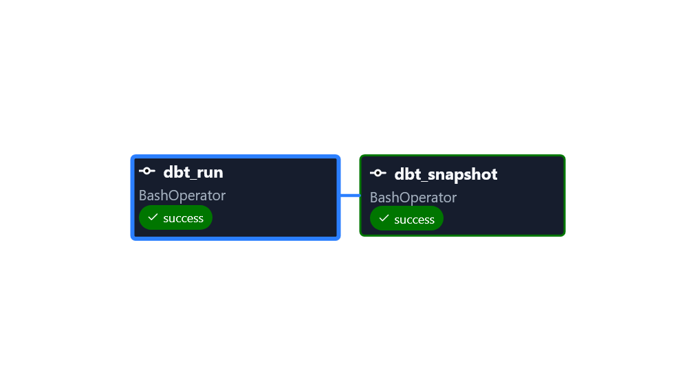
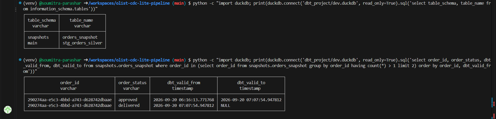

# olist-cdc-lite-pipeline

A change-data-capture-style project pipeline built on the [Olist e-commerce dataset](https://www.kaggle.com/datasets/olistbr/brazilian-ecommerce), simulating a live OLTP system and propagating inserts/updates/deletes through a streaming pipeline into a versioned analytical store.


## Project Overview

My previous project (CoinGecko API project) proved a batch medallion pipeline with orchestration, This project proves something different: handling state that changes over time, inserts, updates, and deletes arriving continously, and correctly reflecting that in an analytical store.

> **"CDC-lite" is a deliberate scope decision.** This pipeline simulates CDC via a dual-write pattern, the generator writes to postgres and publishes the matching event to Kafka directly, rather than true log-based CDC. It does not read the database write-ahead log (no Debezium). The event generator writes each change to postgres and published it to Kafka itself. That keeps the focus on the downstream half of CDC which is streaming ingestion, idempotent upserts and history tracking.


## Architecture

```
Python event generator (SQLAlchemy) → dual-writes to Postgres (OLTP Source) 
        |
        └──────────►  Kafka/Redpanda (topic: order-events)
                            │
                            ▼
                Spark Structured Streaming 
        (parse JSON → typed columns → Delta MERGE INTO)
                            │
                            ▼
                    Delta Table: orders_silver
                            │
                            ▼
                dbt-duckdb (delta_scan)
                ├── stg_orders_silver (staging view)
                └── orders_snapshot (SCD Type 2 history)
                            ▲
                            │ triggers dbt run + dbt snapshot
                        Airflow (docker compose)
```

## Tech Stack

- Postgres
- Kafka (Redpanda)
-  Spark Structured Streaming
- Delta Lake
- Airflow

| Layer | Tool | Description |
|---|---|---|
| Source simulation | Python, SQLAlchemy | Inserts new orders and advances them through their lifecycle, writing to both Postgres and Kafka |
| Transport| Kafka (Redpanda) | Holds order events on the `order-events` topic |
| Streaming ingest | Spark Structured Streaming | Reads from Kafka, parses JSON into columns, upserts into Delta with 'MERGE INTO' |
| Storage | Delta Lake | 'orders_silver', holding the latest state of each order |
| Transformation | abt (dbt-duckdb) | Staging model over the Delta table, plus an SCD Type 2 snapshot |
| Orchestration | Airflow 3 (LocalExecutor) | Runs `dbt run` then `dbt snapshot` |

## Target Tables

 To demonstrate a live streaming change event CDC pipeline, i only used the tables which have somethig that gets inserted, updated, deleted over time as they have a believable change story unlike static/refernce tables such as 'geolocation'

**`orders`** - has the clearest life cycle: insert (order placed) → update (status:pending → shipped → delivered OR occassionally cancelled).

**`order_items`** - gave me another angle for life cycle as items get added to an order after creation.

**`order_reviews`** - gives a natural delete/revision scenario as review gets submitted, sometimes edited or removed.

## Key design decisions

- **Streaming and batch are decoupled.** Spark runs continously on its own. Airflow only orchestrates the batch work downstream(dbt). I chose not to wrap the streaming job in an Airflow task.

- **Idempotent upserts**. `MERGE INTO` on `order_id` means replayed or duplicated events dont create duplicate rows.
- **Partial update events.** Update events only carry the fields that changed status (status and one timestamp), so every other column arrives as `null`. The merge uses `COALESCE(source,target)` so nulls never overwrite existing values. Within each micro-batch, events are forward filled per order and reduced to the latest row before merging, this ensures two events for the same order in one batch cannot overwrite each other. 
- **History lives in dbt, not Spark.** The delta table holds current state. SCD Type 2 history comes from a dbt snapshot (`strategy='check'` on the order status and date columns) this ensure it doesnt depend on event timestamps being strictly ordered.


## Repository layout

```
├── airflow 
├── dbt_project
├── docs
├── event_generator
├── spark_streaming
├── .env.example
├── .gitignore
├── docker-compose.yml
├── load_data.py
├── README.md
└── requirements.txt
```
## Running it

Developed and tested in GitHub Codespaces.

** Prerequisites:** Python 3, Docker, and Java 17 ( for PySpark 4.2; set JAVA_HOME if your default Java is newer.)

1. **Install dependencies and configure environment**

```bash
pip install -r requirements.txt
cp .env.example .env
```

 Download the [Olist e-commerce dataset](https://www.kaggle.com/datasets/olistbr/brazilian-ecommerce) from kaggle.

 Set the postgres values in `.env` (user, passoword, database, port).

2. **Start Postgres and RedPanda**

```bash
docker compose up -d
```

3. **Load the Olist dataset into Postgres** (run from the repo root)
```bash
python load_data.py
```

4. **Start the event generator**
```bash
cd event_generator.py
```
5. **Start the Spark streaming job** (in a second, terminal, while the generator is running)
```bash
cd spark_streaming && python delta_upsert_writer.py
```

The first run downloasd the Kafka and Delta jars. Leave both of them running for a few batches so `orders_silver` fills up.

6. **Start Airflow**
```bash
cd airflow
docker compose up airflow-init
docker compose up -d
```
Open the Airflow UI on port 8080 (default login `airflow`/ `airflow`).
7. **Trigger the DAG** `olist_cdc_dbt` from the UI. It runs `dbt run`, then `dbt snapshot`.

## Results 

** Airflow DAG run: ** both tasks succeed, `dbt_run` then `dbt_snapshot`.



**SCD Type 2 history: ** one order moves from `approved` to `delivered`. The first row is closed with a `dbt_valid_to` timestamp, and the current row has `dbt_valid_to` empty.



**Upsert check:** in a test run the Delta table's row count equalled to its distinct 'order_id` count, so the merge produced one row per order.

## Problems faced and how they were solved

- **Kafka client not delivering.** My first producer used `kafka-python`, it ran without errors, but the topic's high water mark stayed at 0, so nothing reached RedPanda. Adding a delivery check turned it into a `KafkaTimeoutError` and pinning `api_version` didnt help.

Fix- Switching to `confluent-kafka`(librdkafka) with a delivery callback fixed it.

- **Containers couldnt reach each other.** Connections between containers on a custom Docker network timed out with 100% packet loss, even though DNS resolved.

Cause: A split firewall, `iptables-legacy` had a `FORWARD` policy of `DROP` with no rules for the custom bridge, while the `nftables` side was `ACCEPT`.

Fix:
        ```bash
        sudo iptables-legacy -P FORWARD ACCEPT
        ```
        This isnt persistent, so it needs re-running after a codespace restart.

## Limitation and next potential steps

- Change capture is application-level, not log based. Moving to Debezium is the natural next step.
- The DAG is manually triggered. A schedule is a one-line change (`schedule=...`).
- Snapshot history is only as fine-grained as the snapshot frequency. If an order changes status several times between two runs, only the states present at run time are recorded.
- `op_type` and `event_timestamp` in `orders_silver` reflect the first event seen for an order, not the latest, because the merge only updates the business columns. Nothing downstreams uses them. Planned fix: include them in the merge update.
- No dbt tests yet on the staging model or snapshot.
- Only inserts and status updates are simulated, not deletes. 


